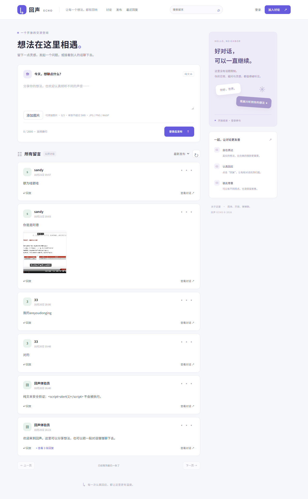

# 回声 ECHO · 留言板

一个支持任意层级回复的留言板。按 [需求说明书](docs/requirements.md) 的 P0 范围开发，提供中文网页、真实 PostgreSQL 数据库、自动迁移、自动化测试和跨平台启动脚本。

如果你是第一次运行解压后的代码，请先阅读根目录的 [START_HERE.md](START_HERE.md)；它按环境准备、启动、配置、验收和邮件提交顺序整理了完整步骤。

## 项目总览与截图

如果你第一次接手这个项目，建议先读 [项目设计与实现汇报](docs/project-summary.md)。这份文档按“页面 → 数据流 → 前端 → 后端 → 数据库 → 验证结果”的顺序说明项目思路，并附有桌面、移动端、多层回复、登录操作区和搜索/通知面板截图。



项目的核心流程是：浏览器中的 Vue 页面通过 `/api` 调用 Spring Boot；后端在事务中校验用户、父留言、线程状态和幂等请求，再通过 MyBatis 写入 PostgreSQL。留言使用 `parent_id + root_id` 保存父子关系，页面按分支分页和聚焦地址加载，因此支持无限层级而不需要一次返回整棵树。

| 先看什么 | 文档 |
|---|---|
| 快速理解项目、功能截图、表关系 | [项目设计与实现汇报](docs/project-summary.md) |
| 数据流、关键设计、完整 API | [技术设计](docs/architecture.md) |
| 三阶段改造的测试证据 | [三阶段验证报告](docs/test-report-2026-10-24-three-phase.md) |
| 交付邮件、源码打包和跨平台启动 | [交付与启动说明](docs/DELIVERY.md) |

## 已实现

- 注册、登录、注销；访客可阅读，登录用户可发布、回复和删除自己的留言。
- 真正的父子关系：任意有效留言都可以继续回复，不把深层回复强制归为二级。
- 根留言按最新/最早排序，每个分支独立按时间分页；同一时间以 ID 稳定排序。
- 深层浏览限制视觉缩进并提供线程线、父留言摘要、祖先面包屑和可分享的聚焦地址；不会为了定位深层留言加载整棵树。
- 删除清空本条正文并保留占位和所有后代；已删除节点不能直接新增回复，其有效子节点仍可回复。
- 展开、收起、聚焦分支、上级导航；迭代遍历，最多显示 200 张卡片，缓存最多 40 个分支。
- 网络失败保留草稿；创建使用幂等请求编号，重试不会重复发布。
- 后端权限、CSRF、Argon2id 密码散列、请求限流、正文和请求体限制、统一错误与请求编号。
- 管理员举报处理、留言隐藏/恢复、线程锁定/归档、用户封禁和治理审计；隐藏留言仍保留讨论关系但不再返回正文。
- 留言可选上传最多 3 张图片；支持 JPG、PNG、WebP（WebP 会清理元数据并转成 PNG），单张不超过 5 MB。文件保存在本机上传目录，数据库保存归属、顺序、格式、尺寸和清理状态等元数据。
- 图片按用户日额度和临时待发布容量限制，生产配置会强制固定分页密钥、HTTPS Cookie 和绝对上传目录。
- 留言支持 15 分钟编辑窗口、版本冲突检查和作者可见的编辑历史；编辑后的内容仍按纯文本处理。
- 回复作者可收到通知，通知支持分页、去重和已读状态；已删除或隐藏留言不会继续出现在通知列表。
- 支持公开文字搜索、签名游标分页和线程统计；搜索结果过滤删除与隐藏内容。
- 管理员工作台支持查看举报、隐藏留言、忽略举报和查看审计记录，后端继续强制校验管理员身份。
- 360px 手机布局和桌面布局，键盘可操作，所有内容以纯文本显示。

## 技术栈与中间件

| 层 | 实际使用 | 用途 |
|---|---|---|
| 前端 | Vue 3.5.44、TypeScript 5.9.3、Vite 7.3.7 | 页面、类型检查、开发代理和生产构建 |
| 后端 | Java 21、Spring Boot 3.5.16 | HTTP API、事务和应用配置 |
| 身份安全 | Spring Security、Argon2id | Session 登录、CSRF、授权、密码散列 |
| 数据访问 | MyBatis starter 3.0.5、HikariCP | 参数化 SQL、连接池 |
| 数据库 | PostgreSQL 17.11 | 用户、树结构、幂等记录、图片元数据和事务锁 |
| 数据迁移 | Flyway | 启动时执行版本化数据库迁移 |
| 单进程限流 | Caffeine | 有大小上限的窗口计数缓存 |
| 测试 | JUnit 5、Spring Boot Test、MockMvc、Vitest 4.1.12 | 集成、并发、规模、状态与前端测试 |
| 本地数据库辅助 | Zonky embedded-postgres 2.2.2 | 下载并启动真实 PostgreSQL 进程；不属于生产包 |

唯一必须独立运行的基础设施是 PostgreSQL。没有使用 Redis、Kafka、RabbitMQ、Elasticsearch、Nginx 或微服务。Spring Boot 自带 Tomcat；开发阶段 Vite 负责前端服务。Session 和限流状态在后端内存中，因此首版按单实例运行，重启后需要重新登录。

## 在这台 Windows 电脑启动

当前项目目录为 `D:\practice`。本机默认 Java 是 17，已经为本项目在 `.tools` 准备了独立 Java 21；脚本会优先选择可用的 Java 21，不要求更改系统默认 Java。

**先打开一个 PowerShell 窗口启动后端。** `Set-Location` 切换项目目录；`-NoProfile` 避免加载个人脚本；`-ExecutionPolicy Bypass` 只针对这次 PowerShell 子进程；`-File` 执行项目启动脚本。

```powershell
Set-Location D:\practice
powershell.exe -NoProfile -ExecutionPolicy Bypass -File .\scripts\start-backend.ps1
```

该脚本编译后端，启动 `127.0.0.1:55432` 的本地 PostgreSQL，再启动 `127.0.0.1:8080` 的 API。看到 `Started DevApplication` 即后端就绪。首次运行需要联网下载 Maven 依赖和 PostgreSQL 二进制文件，稍慢属于正常情况。

**再打开第二个 PowerShell 窗口启动前端。** 脚本首次会按锁文件安装前端依赖，再启动 Vite。

```powershell
Set-Location D:\practice
powershell.exe -NoProfile -ExecutionPolicy Bypass -File .\scripts\start-frontend.ps1
```

浏览器访问 **[http://127.0.0.1:5173](http://127.0.0.1:5173)**。前端会把 `/api` 请求代理到后端。

- 自行点击右上角“加入讨论”注册；密码为 9～128 个字符，支持空格。邮箱可选，用于验证和找回密码。注册成功后登录。
- 可选使用本机浏览器验收创建的演示账号：`echo_demo`，密码 `echo demo local 2026!`。这是本地演示数据，不是程序内置账号；新数据库不会自动创建。
- 在两个启动窗口分别按 **Ctrl+C** 停止进程；关闭前请等待后端退出，以便数据库正常停止。
- 默认本地模式也可执行 `powershell.exe -NoProfile -ExecutionPolicy Bypass -File .\scripts\stop-backend.ps1`，通过项目控制文件正常关闭 API 和 PostgreSQL；该脚本不强制终止其他 Java 进程。
- 开发数据保存在 `.runtime/postgres`，重启保留。不要删除此目录，也不要对它同时启动两个 PostgreSQL 进程。
- 8080、5173、55432 被占用时，先检查是否已经有本项目在运行；不要重复启动。
- 本地辅助数据库只监听 loopback，使用开发用 trust 认证；仅用于本机开发，不能作为公网数据库配置。

如果项目被复制到另一台电脑，需要先安装 **JDK 21、Maven 3.6.3+、Node.js 20.19+ 或 22.12+（推荐 22 LTS）**，并设置 `JAVA_HOME` 指向 JDK 21。`.tools`、`.runtime`、`node_modules` 不应提交到版本库。

## 使用自己安装的 PostgreSQL

为应用建立独立用户和空数据库，推荐与本项目验证环境一致的 PostgreSQL 17.11。启动 API 前设置环境变量：

```powershell
$env:DATABASE_URL = "jdbc:postgresql://127.0.0.1:5432/message_board"
$env:DATABASE_USER = "message_board"
$env:DATABASE_PASSWORD = "替换成数据库用户密码"
$env:CURSOR_SECRET = "替换成至少32字节的随机密钥"
powershell.exe -NoProfile -ExecutionPolicy Bypass -File .\scripts\start-backend.ps1 -ExternalDatabase
```

`-ExternalDatabase` 表示连接已有数据库，不启动本地辅助 PostgreSQL。该路径会编译并运行生产 JAR，Flyway 自动建表，不需要手工执行 SQL。这里的 `-DskipTests` 仅用于启动时避免重复跑测试，**不代表测试通过**；验收用下面的测试命令。

如果要实际发送邮箱验证和密码找回邮件，还需配置 SMTP。`SPRING_MAIL_*` 由 Spring Boot 邮件组件读取，`MAIL_FROM` 和 `PUBLIC_URL` 由应用读取：

```powershell
$env:PUBLIC_URL = "https://你的域名"
$env:SPRING_MAIL_HOST = "smtp.example.com"
$env:SPRING_MAIL_PORT = "587"
$env:SPRING_MAIL_USERNAME = "noreply@example.com"
$env:SPRING_MAIL_PASSWORD = "替换成 SMTP 凭据"
$env:MAIL_FROM = "noreply@example.com"
```

未配置 SMTP 时，本地只记录脱敏的开发提示，不会把重置令牌放进 HTTP 响应；公网部署前必须完成邮件配置和实际收信验收。

也提供 [compose.yml](compose.yml)。安装 Docker 后，将 `.env.example` 复制为 `.env` 并更换数据库密码，再执行 `docker compose up -d postgres`。`-d` 表示在后台启动容器。Docker Compose 会读 `.env`；**Spring Boot 不会自动读取这个文件**，API 仍须设置上面的环境变量。

Docker 路径在本机没有执行验证，因为本机未安装 Docker；已验证的默认路径不依赖 Docker。

## 测试与维护

以下命令依次运行后端测试并打包、首次按锁文件安装前端依赖、检查 TypeScript、构建前端和运行 Vitest。集成测试创建自己的临时 PostgreSQL，**不会连接或清空开发数据库**。

```powershell
Set-Location D:\practice
powershell.exe -NoProfile -ExecutionPolicy Bypass -File .\scripts\test.ps1
```

后端结果在 `backend/target/surefire-reports`，查询计划与规模实测在 `backend/target/scale-evidence.txt`；三阶段增强记录见 [三阶段验证报告](docs/test-report-2026-10-24-three-phase.md)，首版基线见 [历史测试报告](docs/test-report.md)。

需要从锁文件重新安装前端依赖时，先停止 Vite，再给测试脚本加 `-CleanInstall`。Windows 下运行中的 Vite 会占用 `esbuild.exe`，同时运行 `npm ci` 会出现 `EPERM` 文件占用错误；普通测试无需每次重装依赖。

HTTP 压测单独开启，不在每次普通测试中运行。先在 PowerShell 加载项目环境并选择 Java 21，然后进入后端执行指定测试；`-Dboard.load=true` 显式开启耗时压测。默认 5 分钟预热、1 分钟测量，使用 50 个读取客户端和 10 个写入客户端，每个客户端每秒最多 5 个请求。

```powershell
Set-Location D:\practice
. .\scripts\environment.ps1
Use-ProjectJava
Set-Location backend
mvn.cmd "-Dtest=LoadAcceptanceTest" "-Dboard.load=true" test
```

压测报告写入 `backend/target/load-evidence.txt`。错误请求单独统计，429/失败不会被纳入成功请求的延迟。

建议每次改动执行测试；更新前端依赖后额外执行 `npm.cmd audit`。修改表结构应新增 `V2__描述.sql` 等迁移文件，**不要修改已经在使用的 V1**。幂等记录首版保留，不自动清理；以后增加清理任务时必须保留至少 24 小时并处理并发。

前端还提供真实浏览器深层展开回归脚本。先启动前后端，再从项目根运行下面两条命令。第一条打开隔离浏览器，第二条连续展开 85 层测试数据，检查聚焦、卡片数量和手机横向溢出；结束后恢复真实 API，不往开发数据库写测试留言。首次使用会下载 Playwright CLI，可能需要按提示安装浏览器。

```powershell
npx.cmd --yes --package @playwright/cli playwright-cli -s=board-check open http://127.0.0.1:5173
npx.cmd --yes --package @playwright/cli playwright-cli -s=board-check run-code --filename frontend/tests/browser-depth-smoke.js
```

## 项目结构

```text
backend/
  pom.xml
  src/main/java/dev/messageboard/
    auth/                 注册、登录、会话和限流
    comment/              留言、图片上传、编辑历史、搜索、统计、治理与游标
    notification/         回复通知、分页和已读状态
    common/               参数检查、错误、请求保护和 UUID 映射
  src/main/resources/
    application.yml
    db/migration/         Flyway 迁移
  src/test/java/          PostgreSQL 集成、并发、规模和 HTTP 压测
frontend/
  src/App.vue             留言板与登录/删除交互
  src/api.ts              API、CSRF 和会话过期处理
  src/tree.ts             有界树遍历和提交幂等编号
  src/*.test.ts           前端单元测试
  src/style.css           响应式样式
scripts/                  Windows、Linux/macOS 启动、测试与源码打包入口
docs/                     调研、需求、技术设计、验收报告
compose.yml               可选的外部 PostgreSQL 容器
```

## 重要业务约定

- “无限层级”指没有业务设定的深度上限，不意味着一次返回无限数据。接口每次最多 100 条，页面默认每页 20 条，深链用聚焦继续浏览；聚焦地址使用 `?focus=<留言ID>`，祖先路径可以继续按签名游标加载。
- 切换排序或重试请求保留当前草稿；退出或切换账号清空草稿。刷新浏览器、关闭页面会丢失未提交草稿。
- 分页不是数据库快照。并发发布时新留言可能需要刷新才能看到，不承诺自动实时出现。
- 正文为纯文本，不会执行 HTML、脚本或 Markdown。昵称不是身份标识，权限以用户 ID 为准。
- 已删除内容不会通过列表、详情或幂等重放返回；作者信息和结构仍保留。
- 密码找回、管理员审核、举报、通知、搜索和线程统计已经接入；点赞、实时消息、对象存储和 CDN 仍属于后续范围。
- 公网部署还需要 HTTPS、`COOKIE_SECURE=true`、稳定的随机 `CURSOR_SECRET`、数据库备份与恢复演练、管理和治理能力。不要直接把本地开发服务器暴露到公网。
- 使用 `prod` profile 时还会强制检查 `CURSOR_SECRET`、`COOKIE_SECURE=true`、`PUBLIC_URL=https://...` 和绝对路径 `UPLOAD_DIR`；管理员账号通过 `ADMIN_USER_IDS` 配置已有用户 UUID。
