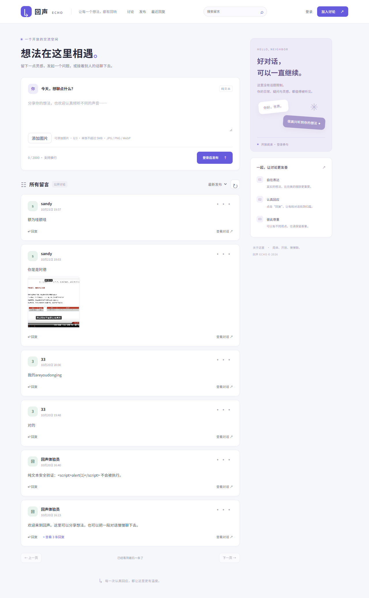
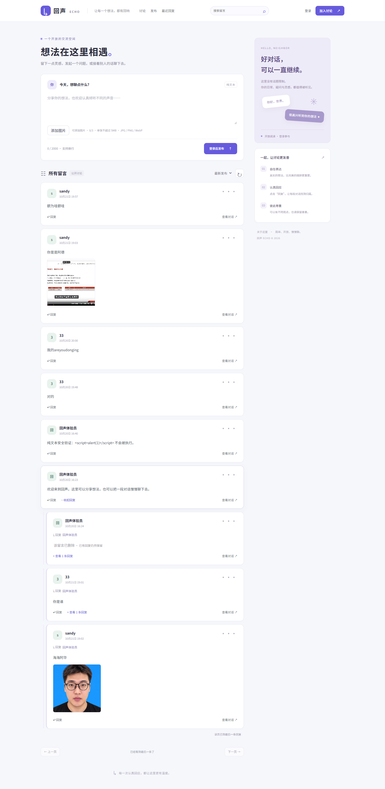
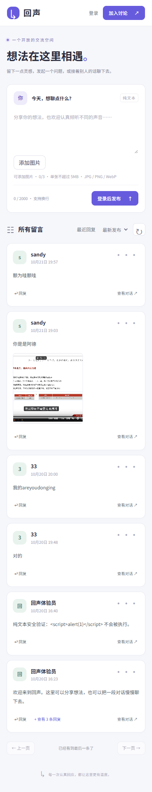
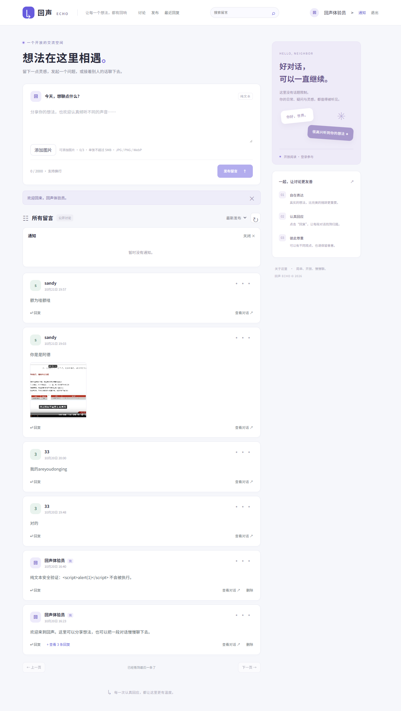
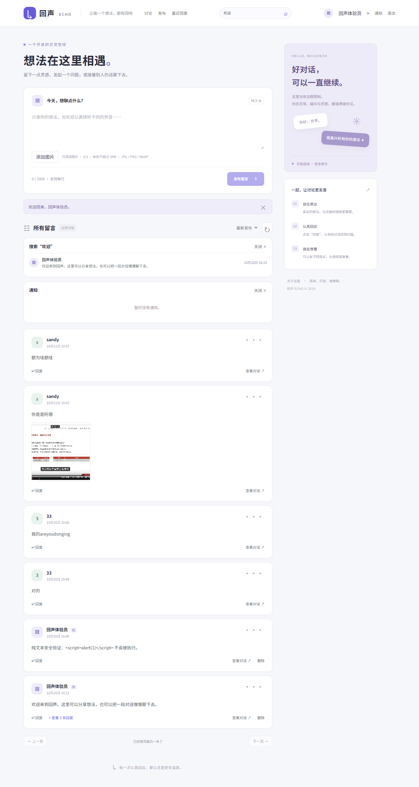
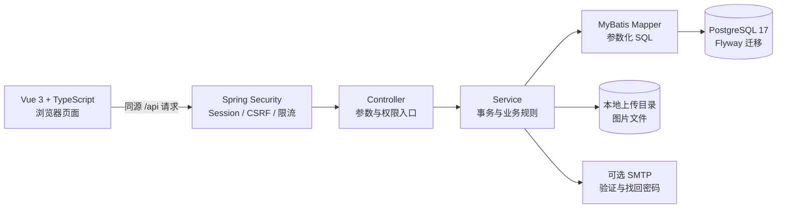
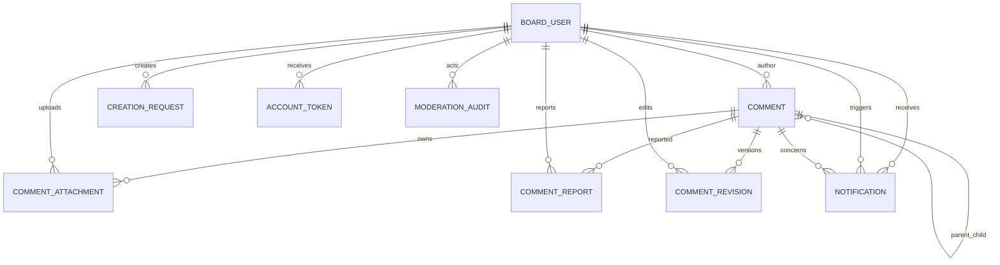

# 回声 ECHO 留言板：项目设计与实现汇报

> 这是一份面向项目接手者的总览文档。它说明项目解决什么问题、前后端如何协作、无限层级留言如何存储与查询、数据库有哪些表，以及当前已经落地的功能。

## 1. 项目一句话说明

回声 ECHO 是一个支持**无限层级回复**的留言板。访客可以浏览公开讨论，注册用户可以发布文字留言、回复、上传图片、编辑和删除自己的留言；系统还提供搜索、最近回复、通知、举报和管理员治理能力。

“无限层级”表示数据库和业务规则不设置二级、三级这样的深度上限。页面不会一次性把整棵树全部加载，而是沿着用户正在阅读的分支按需分页，因此深层讨论仍可以继续使用。

## 2. 先看页面：当前功能截图

以下截图来自本机当前运行的前后端（前端 `5173`、API `8080`、PostgreSQL `55432`）。截图中的留言是本地开发数据，图片和账号仅用于演示。

### 桌面首页：发布区、根留言和侧栏



页面左侧是主要讨论区：顶部发布留言，中间是根留言列表，底部是分页；右侧是产品说明和使用引导。发布区会直接提示正文长度和图片限制，访客可以阅读但需要登录才能发布。

### 展开回复：父子关系和图片留言



点击“查看回复”后，子留言会紧跟在父留言下面，并通过左侧线程线、缩进和“回复某人”标记表达层级。每个分支单独分页，图片以懒加载缩略图展示；删除留言时结构仍保留，页面显示占位文本，已有子回复不会被误删。

### 手机布局：360～390px 宽度可用



移动端收起右侧介绍栏，保留发布、排序、回复、聚焦和分页等主流程；操作按钮有足够的触摸区域，页面没有横向滚动条。

### 登录后的操作区



登录后，右上角显示当前用户、通知和退出入口；发布区从“登录后发布”变成“发布留言”，本人留言会显示“我”和删除入口。编辑、编辑历史、举报和回复按钮根据权限与留言状态动态出现。

### 搜索和通知面板



顶部搜索会打开搜索结果面板，结果只包含可见且未删除的文字。通知面板用于查看别人回复自己的留言；通知支持已读状态，当前演示账号没有未读通知时显示空状态。

## 3. 功能范围

### 3.1 访客和注册用户

| 功能 | 访客 | 登录用户 | 说明 |
|---|---:|---:|---|
| 浏览公开留言 | ✓ | ✓ | 根留言和各分支按游标分页 |
| 注册、登录、注销 | 需要注册 | ✓ | Session + CSRF，密码使用 Argon2id |
| 发布文字留言 |  | ✓ | 正文必填，1～2000 字符，按纯文本渲染 |
| 回复任意留言 |  | ✓ | `parent_id` 指向直接父留言，深度不设上限 |
| 上传图片 |  | ✓ | 最多 3 张，每张 5MB，JPG/PNG/WebP；WebP 会转成 PNG |
| 编辑留言 |  | 作者 | 发布后 15 分钟内，带 revision 乐观并发检查 |
| 查看编辑历史 |  | 作者 | 只允许作者查看自己的旧版本 |
| 删除留言 |  | 作者 | 软删除正文，保留节点和子回复 |
| 搜索、聚焦、最近回复 | ✓ | ✓ | 搜索过滤隐藏和删除内容；聚焦地址可分享 |
| 回复通知 |  | ✓ | 回复作者时通知父留言作者，自己回复自己不会产生通知 |

### 3.2 治理和运营能力

- 用户可以举报留言；同一用户对同一留言只能保留一条未重复举报。
- 管理员可以隐藏/恢复留言、锁定/归档线程、封禁/解封用户、处理举报，并查看治理审计记录。
- 隐藏内容仍保留父子关系，普通用户看不到正文；管理员操作会落入 `moderation_audit`。
- 线程支持 `open`、`resolved`、`locked`、`archived` 状态，状态由后端权限校验，前端只是展示入口。

## 4. 总体架构

项目采用单体分层架构，前后端通过 JSON API 通信，数据库是 PostgreSQL。当前按单实例设计，不依赖 Redis、消息队列或搜索服务。



一次发布留言的核心路径是：

1. 前端检查正文、图片数量和字数，生成 `requestId`。
2. 图片先上传到临时批次，后端验证文件头、解码结果、尺寸和额度，数据库写入图片元数据。
3. `POST /api/comments` 带上正文、父留言 ID、批次 ID 和 `requestId`。
4. `CommentService` 在事务中锁定父节点，检查线程状态、权限和幂等记录，计算 `root_id` 后插入留言。
5. 成功后绑定临时图片、保存幂等结果；如果这是回复，再写入通知。
6. 前端只更新当前分支，失败时保留草稿，重试不会重复创建同一条留言。

## 5. 前端设计

### 5.1 主要文件

```text
frontend/src/
  App.vue       页面状态、登录、发布、回复、编辑、搜索、通知、管理面板
  api.ts        API 请求封装、CSRF、会话过期和 TypeScript 类型
  tree.ts       有界迭代遍历、分支分页状态、发布幂等提交
  ui.ts         回复数量、聚焦、附件提示、线程状态等展示规则
  style.css     桌面/移动端布局、卡片、线程线、面板和可访问焦点样式
  *.test.ts     API、树遍历和 UI 规则单元测试
```

### 5.2 无限层级为什么不会一次性拖垮页面

页面使用“可见行”迭代算法，而不是递归组件无限调用：

- 初始只拉取根留言，每页默认 20 条。
- 点击某条留言的回复按钮后，只请求这条留言的直接子节点。
- 每个父节点维护自己的 cursor、历史页、加载状态和错误状态。
- 当前视图最多展示 200 张卡片，分支缓存有上限；深链或缓存达到上限时转为聚焦当前留言，保护正在阅读的祖先路径。
- `?focus=<留言ID>` 可以直接打开深层留言；后端返回有限祖先、目标留言和首屏子回复，祖先还可以继续按签名游标加载。

这样既保留了任意深度，又避免“打开一条深层留言就递归加载整棵树”。

### 5.3 交互状态

前端主要维护这些状态：当前用户、根分支、分支缓存、聚焦留言、祖先面包屑、发布草稿、图片批次、编辑状态、搜索结果、通知和管理员数据。网络请求失败时，留言草稿不清空；切换账号或退出时清理草稿。

## 6. 后端设计

### 6.1 模块职责

```text
backend/src/main/java/dev/messageboard/
  auth/          注册、登录、Session、密码找回、限流
  comment/       留言树、游标、图片、编辑历史、搜索、线程统计、治理
  notification/  回复通知、分页、去重和已读
  common/        参数检查、统一错误、请求保护、生产配置和 UUID 类型
```

请求处理遵循 `Controller → Service → Mapper → PostgreSQL`：Controller 负责 HTTP 输入输出，Service 负责事务、权限和状态机，Mapper 只执行参数化 SQL。所有 ID 以字符串形式进出 API，未知 JSON 字段会被拒绝。

### 6.2 树结构设计

`comment` 使用邻接表模型：

- `parent_id`：直接父留言，根留言为空。
- `root_id`：讨论根，根留言的 `root_id` 等于自身 ID。
- `created_at + id`：组成稳定排序键，保证同一时间下顺序仍然确定。
- `comment_children_time(parent_id, created_at, id)`：支撑每个分支的直接子节点分页。
- 结构触发器阻止修改父节点、根节点、作者和创建时间，避免数据库外操作形成环或移动整棵树。

### 6.3 删除、编辑和并发

- 删除是软删除：清空正文并写入 `deleted_at`，节点和后代保留；因此父子关系、回复计数和审计仍可追踪。
- 编辑只能由作者在 15 分钟窗口内进行；请求携带 `revision`，旧版本不匹配时返回冲突，避免两个页面互相覆盖。
- 回复和删除会锁定相关节点，创建使用 `user_id + request_id` 并配合事务锁，防止网络重试造成重复留言。
- 游标由服务端 HMAC 签名，绑定父节点、排序方向、时间和 ID；客户端不能伪造其他分支的 cursor。

## 7. 数据库表和关系

当前 Flyway 迁移为 V1～V8，共 10 张业务表和 1 个 PostgreSQL `pg_trgm` 扩展索引。

### 7.1 表清单

| 表 | 作用 | 关键字段/关系 |
|---|---|---|
| `board_user` | 用户账号与安全状态 | 登录名、昵称、Argon2id 密码、邮箱、封禁时间 |
| `comment` | 留言树核心表 | `author_id`、`parent_id`、`root_id`、正文、删除/隐藏/线程状态、编辑版本 |
| `creation_request` | 发布幂等记录 | 用户 + 请求 UUID 唯一，保存正文摘要和结果留言 ID |
| `comment_attachment` | 图片元数据和生命周期 | 所属用户、批次、留言 ID、顺序、存储键、格式、尺寸、清理状态 |
| `account_token` | 邮箱验证和密码找回 | token 哈希、用途、有效期、使用时间 |
| `comment_report` | 用户举报 | 举报人、留言、原因、open/resolved/dismissed 状态 |
| `moderation_audit` | 管理员审计 | 操作者、动作、目标类型/ID、原因、时间 |
| `upload_usage` | 上传额度统计 | 用户/范围 + 日期 + 字节数 |
| `comment_revision` | 留言旧版本 | 留言、编辑者、revision、旧正文、创建时间 |
| `notification` | 回复通知收件箱 | 接收人、触发人、留言、去重键、已读时间 |

### 7.2 关系图



### 7.3 迁移演进

| 迁移 | 增加内容 |
|---|---|
| V1 | 用户、留言树、发布幂等和树结构约束 |
| V2 | 图片附件元数据、临时批次和清理索引 |
| V3 | 邮箱、邮箱验证和密码找回 token |
| V4 | 用户封禁、留言隐藏、线程状态、举报和治理审计 |
| V5 | 用户按日上传字节额度 |
| V6 | 编辑时间窗口、revision 和编辑历史 |
| V7 | 回复通知、去重和未读索引 |
| V8 | PostgreSQL `pg_trgm` 可见正文搜索索引 |

Flyway 在应用启动时自动执行迁移。已经使用过的迁移文件不应修改，后续表结构变更应新增 `V9__...sql`、`V10__...sql` 等版本。

## 8. API 能力分组

| 分组 | 代表接口 | 用途 |
|---|---|---|
| 认证 | `/api/auth/register`、`/login`、`/logout`、`/me` | 用户身份和会话 |
| 留言树 | `/api/comments`、`/{id}/replies`、`/{id}/context` | 根列表、直接子回复、深层聚焦 |
| 留言维护 | `POST /api/comments`、`PUT /api/comments/{id}`、`DELETE /api/comments/{id}` | 发布、编辑、软删除 |
| 发现 | `/api/comments/search`、`/recent-replies`、`/{id}/stats` | 搜索、最近回复、线程统计 |
| 图片 | `/api/uploads/images`、`/api/attachments/{id}` | 两阶段上传、读取和清理 |
| 通知 | `/api/notifications`、`/{id}/read` | 通知分页和已读 |
| 治理 | `/api/comments/{id}/reports`、`/api/moderation/*` | 举报、隐藏、线程治理和审计 |

统一错误格式为 `{message, requestId}`。常见状态码：400 参数错误、401 未登录、403 权限/CSRF、404 不存在、409 状态或 revision 冲突、413 上传超限、429 限流。

## 9. 三阶段改造回顾

### 阶段一：前端层级和可读性

统一回复/聚焦操作，增加附件提示、线程状态、线程统计、编辑态、通知/搜索/管理面板，补充桌面和手机端样式。

### 阶段二：深层导航和发现入口

`/context` 增加祖先继续游标；新增最近回复、搜索和线程统计接口；前端支持分享 `?focus=<id>`、继续加载更早祖先和聚焦当前分支。

### 阶段三：内容生命周期和治理闭环

V6 增加编辑历史和乐观锁，V7 增加通知和已读，V8 增加中文友好的 `pg_trgm` 搜索索引；管理员工作台补齐举报处理和审计查看。

## 10. 验证结果

最近一次验证结果：

- 后端：24 个测试执行，0 失败，0 错误，1 个按配置跳过；Maven 构建成功。
- 前端：3 个测试文件、13 个测试通过；TypeScript 检查和 Vite 构建通过。
- 浏览器深层回归：连续展开 85 层，返回 6 张可见卡片，聚焦点为第 80 层，无横向溢出，无页面错误。
- 打包：`backend/target/message-board-1.0.0.jar` 构建成功。

详细命令和边界见 [三阶段验证报告](test-report-2026-10-24-three-phase.md)。

## 11. 当前边界和后续方向

当前版本按单实例和本地文件存储设计：Session、限流和游标密钥状态在应用进程内，图片文件在本机上传目录，通知通过页面打开时拉取，没有 WebSocket/SSE 实时推送。

如果部署到公网，建议按以下顺序继续：

1. 配置 HTTPS、稳定的 `CURSOR_SECRET`、`COOKIE_SECURE=true` 和绝对上传目录。
2. 把图片迁移到对象存储并接入病毒扫描、缩略图和 CDN。
3. 多实例部署时引入共享 Session、共享限流和异步通知 outbox。
4. 对超大线程把统计改为增量聚合或缓存，并对搜索做词法/分词优化。
5. 增加数据库备份恢复演练、跨浏览器验收和公网渗透测试。

## 12. 继续阅读和运行

- [项目 README](../README.md)：安装、启动、测试和运维命令。
- [技术设计](architecture.md)：数据流、关键设计决策和完整 API 表。
- [需求说明](requirements.md)：留言板 P0 需求范围。
- [三阶段验证报告](test-report-2026-10-24-three-phase.md)：测试证据和验证边界。
- [深层浏览截图](images/echo-thread-expanded.png)：最能体现无限层级实现方式的页面。

